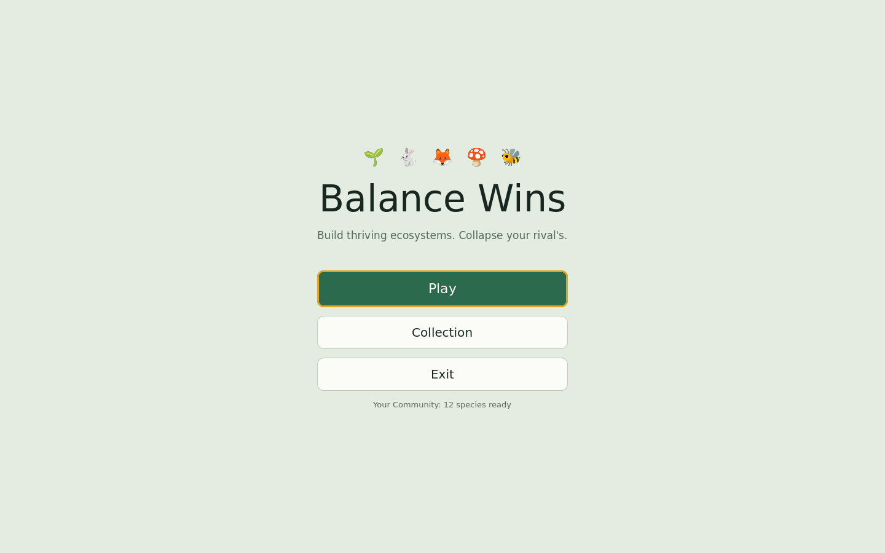
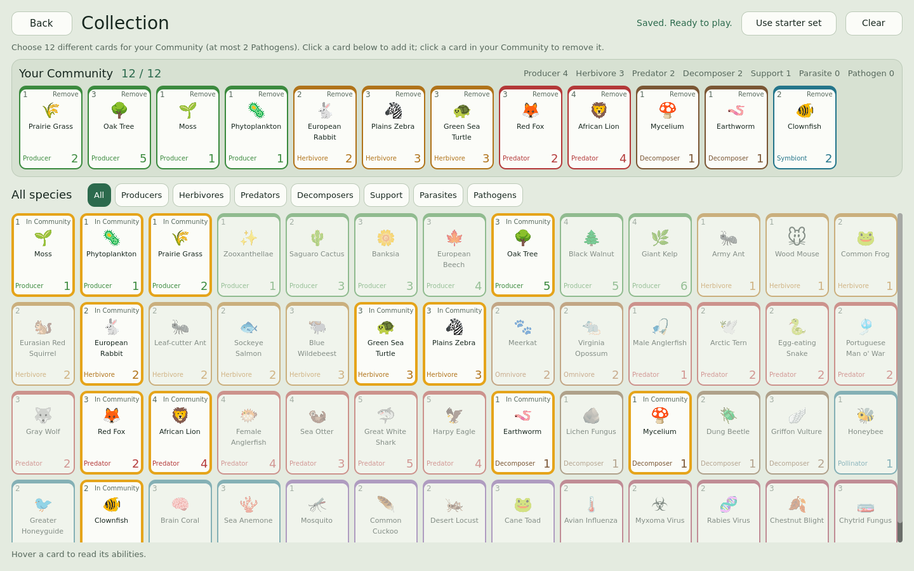
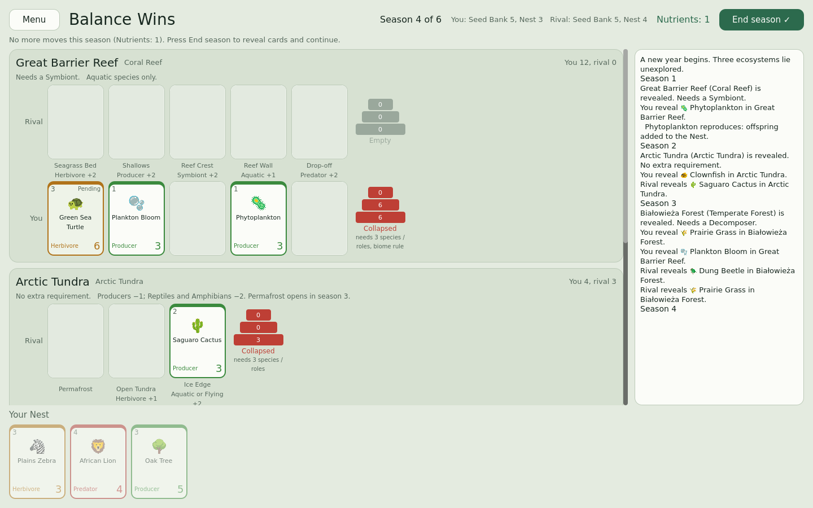

# Balance Wins — Godot 4 prototype

A playable prototype of the ecosystem card battler: build Balanced ecosystems, collapse your rival's.
Standard mode: 3 real-world ecosystems, 6 seasons, win 2 of 3.

| Main menu | Collection | Match |
| --- | --- | --- |
|  |  |  |

## Run it

1. Install **Godot 4.4** or newer (standard version, no C# needed): https://godotengine.org/download
2. Open Godot, click **Import**, choose this folder's `project.godot`.
3. Press **F5** (Run Project).

## Screens

- **Main menu:** Play, Collection, Exit.
- **Collection:** every species in the game. Click a card to add it to your Community, click a Community card to
  remove it, and filter by role. Your Community must have exactly 12 different species; it saves automatically
  (to `user://community.cfg`) whenever it's complete, and "Use starter set" restores the original 12.
  Back returns to the menu (it warns you if your Community is incomplete).
- **Match:** Menu (asks before leaving a match in progress), and at Year's End: Play again or Main menu.

## How to play

- Click a species in **Your Nest**, then click a highlighted zone. Click one of your unrevealed (Pending) cards to take it back.
- Press **End season**. The rival AI places its cards, then all cards reveal and their Emergence abilities trigger.
- A line is **Balanced** when it has at least 3 species covering 3 roles (with a Producer and a consumer),
  Producers ≥ Herbivores ≥ Predators, and it meets its biome rule. The pyramid beside each line shows its status;
  an outlined tier is the one breaking the rule.
- At Year's End, each ecosystem goes to the Balanced player (or the bigger one if both are Balanced). Win 2 of 3.
- Hover a card to see its full text. Cards you can't play right now are dimmed, and End season turns green
  when you have no moves left.

## What's implemented

| System | Status |
| --- | --- |
| Pyramid of biomass, Balanced / At risk / Collapsed, resolution and tiebreakers | Done |
| 7 regions (Białowieża, Serengeti, Great Barrier Reef, Amazon, Sahara, Arctic Tundra, New Zealand) | Done |
| Zone (Niche) bonuses incl. "either/or" zones, native bonus, climates, biome requirements, Island tag | Done |
| Mirrored Residents | Done |
| Emergence and Adaptation abilities (Prey on, Parasitize, Pack, Symbiosis, Resilient, Invasive...) | Done |
| **Pathogens**: Rabies, Avian Influenza, Chytrid, Myxoma, Chestnut Blight; spread at Dusk, dilution, bites, immunity, cures | Done |
| **Merging**: Fusion, Colony, Absorb (Lichen, Zooxanthellae, Brain Coral, Army Ant, Man o' War, Anglerfish) | Done |
| **Migration**: every Dusk (Desert Locust) and seasonal (Arctic Tern, Blue Wildebeest with herd, Sockeye Salmon) | Done |
| **Seed Bank effects**: Hatch, Recruit, Allelopathy, Nest Raid, Seed Predation, Cache, Resprout, Mast Year, Lookout | Done |
| Comebacks: Nutrient Cycling, Succession, Adaptive Pressure | Done |
| Main menu, Collection (52 cards, max 2 Pathogens), saved Community | Done |
| Zone hints (Water only, Land only, End zones only, Locked, Too expensive), readable tooltips | Done |
| Natural Selection, Endemism, Abiotic tokens, Habitat Expansion/Loss, Human set, Expedition, stakes | Not yet |

### Playing pathogens

Select a Pathogen in your Nest; rival species it can infect light up with "Infect". Click one to queue it
(click it again to take it back). It attaches when cards reveal, then weakens and spreads at Dusk. Species of a
different group sitting between hosts block the spread, so diverse lines resist disease.

### Recruit and Lookout

When your Recruit or Lookout species reveals, a picker opens at the start of the next season so you can choose.

## Project structure

```
project.godot
main_menu.tscn, collection.tscn, game.tscn
scripts/data/   CardData, RegionData (Resources) + CardLibrary, RegionLibrary (all content, built in code)
scripts/core/   CardInstance, EcosystemState, Rules (pure rules), MatchManager (match flow), RivalAI,
                game_state.gd (autoload "GameState": saves your Community)
scripts/ui/     ui_kit.gd (shared colors and widgets), main_menu.gd, collection.gd, game.gd
tests/          sim.gd (200 AI-vs-AI matches, random Communities), rules_test.gd (43 rule checks),
                ui_smoke.gd, menu_smoke.gd, screenshot.gd, screenshot2.gd
```

The rules engine has no UI dependency, so it can be tested headlessly:

```
godot --headless --path . --script res://tests/sim.gd
godot --headless --path . --script res://tests/rules_test.gd
godot --headless --path . --script res://tests/ui_smoke.gd
godot --headless --path . --script res://tests/menu_smoke.gd
```

## Extending it

- **New species:** add one `_add(...)` line in `scripts/data/card_library.gd`. Abilities are strings like
  `"symbiosis:Clownfish:2"` or `"adj_role_bonus:Producer:1"`.
- **New ability:** static effects (always on) go in `Rules.compute_value`; on-reveal effects go in
  `MatchManager._emergence`. Biomass is recomputed from scratch after every change, so effects never stack by accident.
- **New region:** add a `_region(...)` entry in `scripts/data/region_library.gd` with its zones, climate ids,
  requirement and Residents. New climate ids go in `Rules.climate_mod`.
- **Communities:** players build theirs in the Collection screen. The starter set is `player_community()` and the
  rival's is `rival_community()` in `card_library.gd`. New species appear in the Collection automatically.

## Suggested next steps

1. Drag-and-drop placement and tween animations for reveals, Perish and migration.
2. Several saved Communities, and letting the rival pick a random themed Community.
3. Move content into `.tres` files so designers can edit cards in the Inspector.
4. Add the remaining v2 systems one at a time, starting with Natural Selection and Pathogens.
5. A smarter AI that simulates Emergence effects and plans across seasons.
